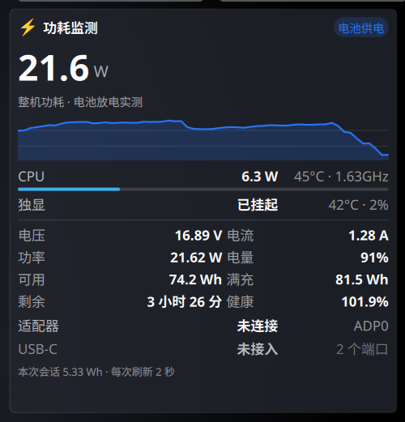

# Power Watch · 功耗监测

一个 **KDE Plasma 6** 桌面小部件，实时显示这台机器的**功耗、电压、电流**。



## 能显示什么

| 项目 | 内容 |
| --- | --- |
| 整机功耗 | 大号数字 + 60 点历史曲线 |
| CPU | 封装功耗（含 core / uncore 分解）、温度、当前频率、占比条 |
| 独立显卡 | 功耗、温度、占用率（NVIDIA） |
| 电池 | 电压、电流、功率、电量、可用/满充容量、剩余时间、健康度、循环次数 |
| 供电 | 交流适配器状态、USB-C PD 端口电压电流 |
| 其他 | 本次会话累计用电量（Wh）、供电方式徽标 |

同一个部件放进**面板**时会自动切换成紧凑态，只显示 `⚡ 22W`。

## 数据从哪来，有多准

| 显示项 | 来源 | 说明 |
| --- | --- | --- |
| 整机功耗 | `/sys/class/power_supply/BAT*/power_now` | **电池放电功率就是整机真实功耗**，最准。插电时这个量在笔记本上拿不到，改为显示 CPU+独显的合计 |
| CPU 功耗 | `/sys/class/powercap/intel-rapl:*` | Intel RAPL 能量计数器差分求得，覆盖 package / core / uncore |
| 电池电压电流 | `/sys/class/power_supply/BAT*` | 有些机型没有 `current_now`，此时由 `功率 ÷ 电压` 推算 |
| 独显 | `nvidia-smi` | 见下方「已知限制」 |
| 适配器 / USB-C PD | `ACPI` / `UCSI` | PD 端口只有接上电源才有读数 |
| 温度 / 频率 | `/sys/class/hwmon/coretemp`、`cpufreq` | |

采集逻辑全部由一个 bash 脚本完成（`contents/scripts/powerwatch-collect`），不依赖 Python、不需要常驻守护进程。

## 依赖

- **KDE Plasma 6**（Plasma 5 不适用）
- `bash` 5、`awk`、`coreutils`
- 可选：`nvidia-smi`（有 NVIDIA 独显时用来读显卡功耗）
- 可选：`python3`（只有 `powerwatch-collect --pretty` 格式化输出时用得到）

## 安装

```bash
git clone https://github.com/AkirTech/plasma-powerwatch.git
cd plasma-powerwatch
./install.sh
```

脚本会把包安装到 `~/.local/share/plasma/plasmoids/io.github.akirtech.powerwatch/`，
并在 `~/.local/bin` 下建两个命令软链接（`--no-bin` 可跳过）。

也可以手动安装：

```bash
kpackagetool6 -t Plasma/Applet -i package
```

装好后：**右键桌面 → 添加部件 → 搜索「功耗监测」**。

### 让 CPU 功耗显示出来

Intel RAPL 的 `energy_uj` 默认权限是 `0400 root`，普通用户读不到 CPU 功耗。
执行一次下面这条命令永久放行（会装一条 udev 规则）：

```bash
sudo ~/.local/share/plasma/plasmoids/io.github.akirtech.powerwatch/contents/scripts/powerwatch-enable-rapl
```

小部件**设置页里会直接显示这条命令的完整路径**，可以直接照抄。
撤销：给同一个脚本加 `--undo`。

不做这一步也能用，只是 CPU 那一行会显示 `—`。

## 配置

右键部件 → 配置：

| 选项 | 默认 | 说明 |
| --- | --- | --- |
| 刷新间隔 | 2 秒 | 采集脚本的调用周期 |
| 独立显卡采样间隔 | 10 秒 | 设为 0 可完全停用独显采样 |
| 功耗历史曲线 | 开 | |
| CPU 功耗与温度 | 开 | |
| 独立显卡功耗 | 开 | |
| 电池电压 / 电流 / 电量 | 开 | |
| 适配器与 USB-C PD | 开 | |
| 本次会话累计用电量 | 开 | |

右键菜单里还有：**立即刷新**、**强制读取独立显卡**。

## 命令行

```bash
# 格式化输出全部原始数据
powerwatch-collect --pretty

# 不采样独显，只看 CPU / 电池
powerwatch-collect --gpu-poll=0

# 即使独显处于挂起状态也读一次（会唤醒独显，更耗电）
powerwatch-collect --force-gpu
```

## 已知限制

1. **插电时没有「整机功耗」这个量。** 笔记本不暴露适配器输入功率，此时大号数字显示的是
   CPU + 独显的合计值，不含屏幕、内存、硬盘、风扇等，属于偏低估计。不插电时读的是
   电池放电功率，那个数字是准的。
2. **独显挂起时不主动唤醒它。** 实测 `nvidia-smi` 每次要 3.5 秒，而且会把挂起的独显拉起来——
   一个每 2 秒跑一次的小部件如果这么干，本身就成了耗电大户。所以只缓存 + 检测
   `/sys/.../power/runtime_status`，挂起时直接显示「已挂起」。
3. 电池电流在部分机型上要换算（见上表）。健康度超过 100% 是正常的，那是
   满充容量比设计容量大。
4. 桌面上的部件会被窗口遮挡，这是 Plasma 的固有行为。想让它一直可见，
   请再往面板上拖一个。
5. Plasma 会缓存已编译的 QML。改完代码执行 `install.sh` 后如果界面没变，
   需要重启 plasmashell：`plasmashell --replace & disown`。

## 给开发者的备注

几个踩过的坑，省得你再踩一遍：

- **`executable` dataengine 不走 shell。** 它用 `QProcess::start(program, args)` 直接切分
  参数，所以 `VAR=value cmd` 这种写法无效，配置只能通过命令行参数传。
- **桌面态必须禁用紧凑/完整切换。** Plasma（Planar 形态）下要把 `switchWidth` 和
  `switchHeight` 都设成 `-1`。否则一旦部件尺寸没超过阈值，它就永远停在紧凑态。
- **桌面部件的 `geometry` 是只读的。** 想用脚本定位只能用配置文件里的
  `ItemGeometries-<宽>x<高>=Applet-<id>:x,y,w,h,0;`，然后重启 plasmashell。
- **`chmod -R /sys/class/powercap` 没用。** `intel-rapl:0` 是符号链接，`-R` 不会递归进去，
  必须用通配符 `chmod a+r /sys/class/powercap/*/energy_uj`。另外授权脚本以 root 运行时
  `[ -r file ]` 永远为真，别用它做验证，要看权限位。

## 许可证

GPL-2.0-or-later，见 [LICENSE](LICENSE)。
